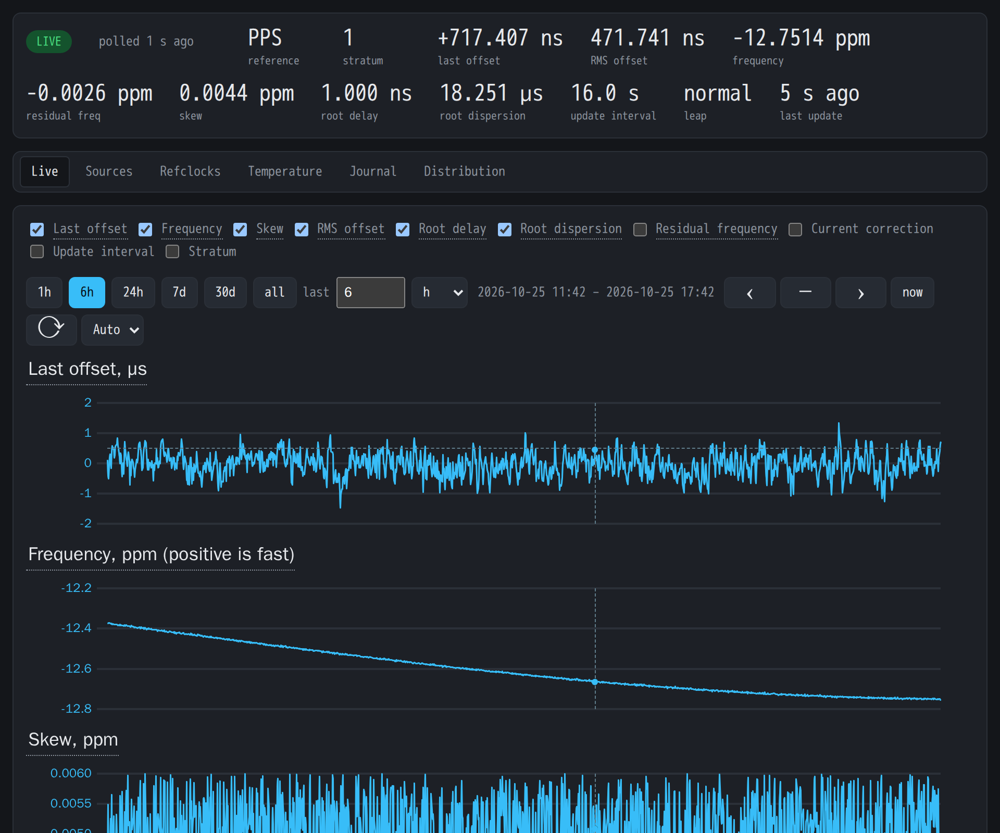
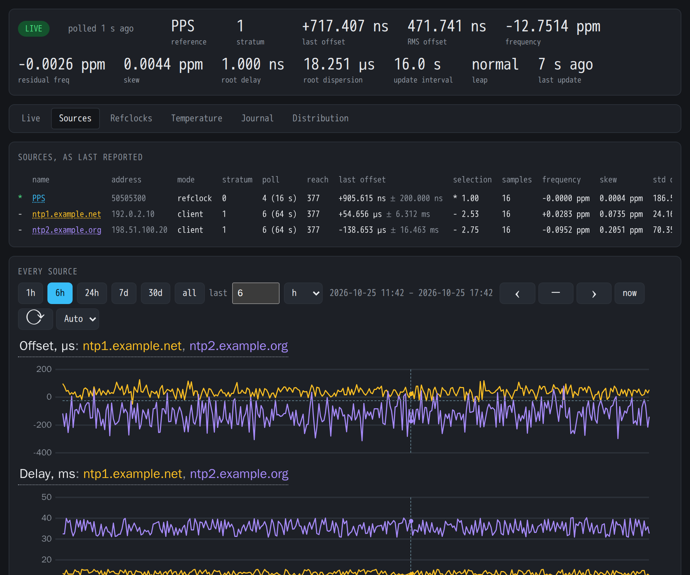
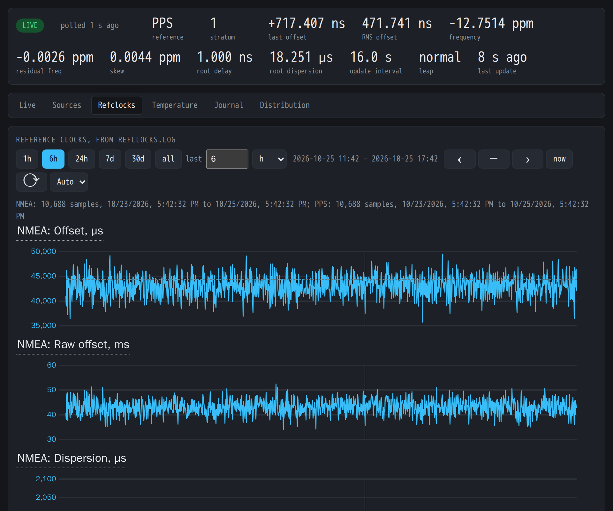
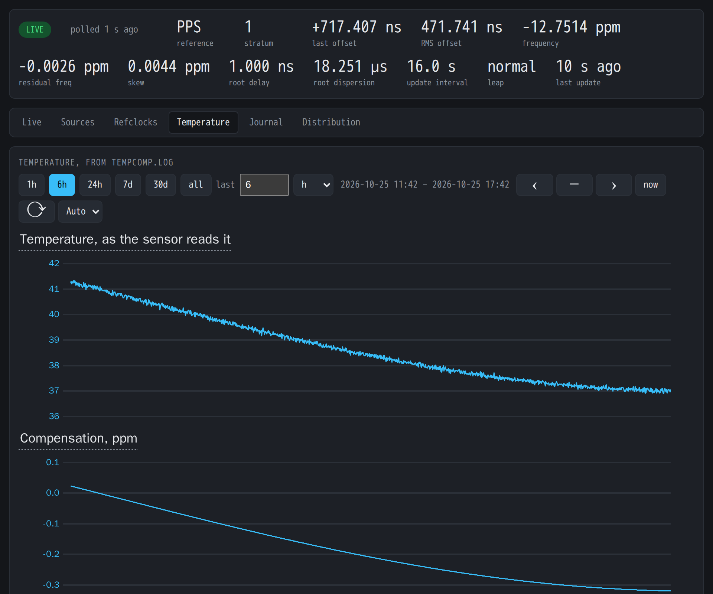
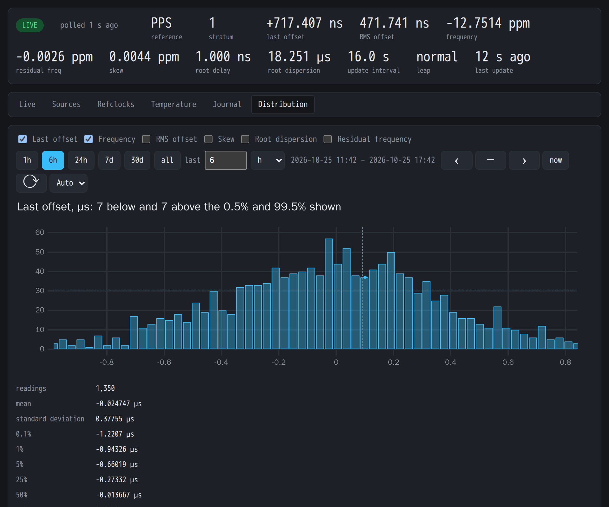
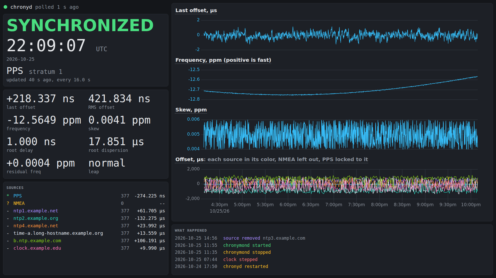

# chronymon

Records chronyd's tracking and source statistics in SQLite and charts
them in a browser.

| Sources | Refclocks |
| - | - |
|  |  |
| **Temperature** | **Distribution** |
|  |  |

Synthetic data; `make screenshots` retakes them.

## Running

One Debian package, `chronymon`, from the
[APT repository](https://github.com/charlieh0tel/apt-repo) or a
release.  It runs both programs; see `docs/running.md`.

- `chronymond` polls chronyd's control socket every second and reads
  chronyd's logs (`log tracking measurements statistics refclocks
  tempcomp`), history included.  It runs as `_chrony`: the socket
  admits only chronyd's user and root.
- `chronymon-web` serves the database read-only on
  `127.0.0.1:8323`, without authentication.  uPlot comes from a CDN.
  `/kiosk` is one screen for a display across a room
  ([options](docs/running.md#kiosk)).

Options: `--help`, or `CHRONYMOND_*` and `CHRONYMON_WEB_*` in the
environment.

## Developing

    cargo run -p chronymon-web --example synthetic -- /tmp/demo.sqlite
    cargo run -p chronymon-web -- --database /tmp/demo.sqlite

    make hooks        # once per clone
    make ci           # fmt, clippy, tests
    make test-web     # browser tests
    make screenshots  # docs/images

The browser targets use Node after `make web-deps`, else Docker.
Design: `PLAN.md`.  Releases: `RELEASING.md`.

## License

MIT OR Apache-2.0.
